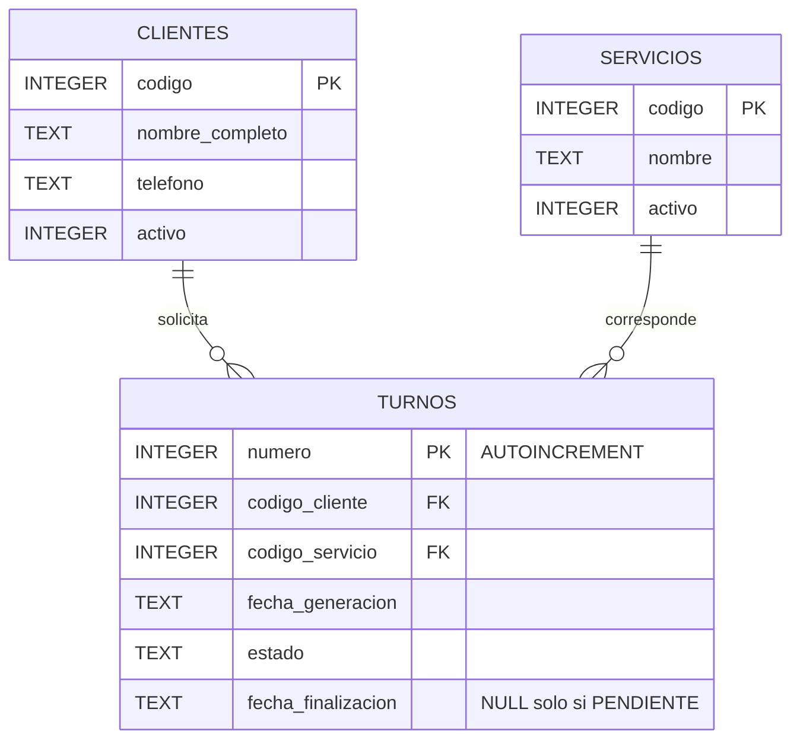

# Diagramas finales

## UML de clases

```mermaid
classDiagram
class Cliente {
  -int codigo
  -String nombreCompleto
  -String telefono
  -boolean activo
  +getCodigo() int
  +getNombreCompleto() String
  +getTelefono() String
  +isActivo() boolean
}
class NodoCliente {
  -Cliente cliente
  -NodoCliente izquierdo
  -NodoCliente derecho
}
class ArbolBST {
  -NodoCliente raiz
  +insertar(Cliente cliente)
  +buscar(int codigo) Cliente
  +inorden() List~Cliente~
  +actualizar(Cliente cliente)
  +estaVacio() boolean
}
class ClienteService {
  +registrar(int codigo, String nombre, String telefono) Cliente
  +buscar(int codigo) Cliente
  +listar() List~Cliente~
  +actualizar(int codigo, String nombre, String telefono) Cliente
  +cambiarEstado(int codigo, boolean activo) Cliente
  +recargarDesdePersistencia()
}
class ClienteRepositorio {
  <<interface>>
  +listar() List~Cliente~
  +buscar(int codigo) Cliente
  +insertar(Cliente cliente)
  +actualizar(Cliente cliente)
}
ArbolBST *-- NodoCliente : raiz y enlaces
NodoCliente --> Cliente
NodoCliente --> NodoCliente : izquierdo / derecho
ClienteService *-- ArbolBST
ClienteService --> ClienteRepositorio
class Turno {
  -long numero
  -int codigoCliente
  -int codigoServicio
  -LocalDateTime fechaGeneracion
  -Estado estado
  -LocalDateTime fechaFinalizacion
}
class EstadoTurno {
  <<enumeration>>
  PENDIENTE
  ATENDIDO
  CANCELADO
}
class NodoTurno {
  -Turno turno
  -NodoTurno siguiente
}
class ColaTurnos {
  -NodoTurno primero
  -NodoTurno ultimo
  +encolar(Turno turno)
  +consultarSiguiente() Turno
  +desencolar() Turno
  +cancelar(long numero) Turno
  +listarPendientes() List~Turno~
  +tienePendienteCliente(int codigo) boolean
  +estaVacia() boolean
}
class TurnoService {
  +generar(int cliente, int servicio) Turno
  +consultarSiguiente() Turno
  +listarPendientes() List~Turno~
  +atenderSiguiente() Turno
  +cancelar(long numero) Turno
  +recargarDesdePersistencia()
}
class TurnoRepositorio {
  <<interface>>
  +listarPendientes() List~Turno~
  +tienePendienteCliente(int codigo) boolean
  +tienePendienteServicio(int codigo) boolean
  +crearPendiente(int cliente, int servicio) Turno
  +finalizar(long numero, Estado estado, LocalDateTime fecha) Turno
}
Turno --> EstadoTurno
ColaTurnos *-- NodoTurno
NodoTurno --> NodoTurno : siguiente
NodoTurno --> Turno
TurnoService *-- ColaTurnos
TurnoService --> TurnoRepositorio
class Servicio {
  -int codigo
  -String nombre
  -boolean activo
}
class ServicioService {
  +registrar(int codigo, String nombre) Servicio
  +buscar(int codigo) Servicio
  +listar() List~Servicio~
  +actualizar(int codigo, String nombre) Servicio
  +cambiarEstado(int codigo, boolean activo) Servicio
}
class ServicioRepositorio {
  <<interface>>
  +listar() List~Servicio~
  +buscar(int codigo) Servicio
  +insertar(Servicio servicio)
  +actualizar(Servicio servicio)
}
class ConsultasTurnosRepositorio {
  <<interface>>
  +buscar(long numero) Turno
  +listarPorEstado(Estado estado) List~Turno~
  +historialCliente(int codigo) List~Turno~
  +resumenPorServicio() List~ResumenServicio~
}
class ClienteDAO
class ServicioDAO
class TurnoDAO
class DaoBase
class ProveedorConexion {
  <<interface>>
  +abrir() Connection
}
class ConexionBD {
  +obtenerConexion() Connection
  +obtenerConexion(Path archivo) Connection
}
class InicializadorBD {
  +inicializar()
}
class ConsultaService {
  +listarPorEstado(Estado estado) List~Turno~
  +historialCliente(int codigo) List~Turno~
  +resumenPorServicio() List~ResumenServicio~
}
class ResumenServicio {
  +int codigoServicio
  +String nombreServicio
  +long pendientes
  +long atendidos
  +long cancelados
  +long total
}
class VistaConsola
class ControladorConsola {
  +ejecutar()
}
class Main {
  +main(String[] args)
}
ClienteRepositorio <|.. ClienteDAO
ServicioRepositorio <|.. ServicioDAO
TurnoRepositorio <|.. TurnoDAO
ConsultasTurnosRepositorio <|.. TurnoDAO
DaoBase <|-- ClienteDAO
DaoBase <|-- ServicioDAO
DaoBase <|-- TurnoDAO
DaoBase --> ProveedorConexion
ClienteDAO ..> ConexionBD : proveedor por defecto
ServicioDAO ..> ConexionBD : proveedor por defecto
TurnoDAO ..> ConexionBD : proveedor por defecto
Main --> InicializadorBD
Main --> ClienteService
Main --> ServicioService
Main --> TurnoService
Main --> ConsultaService
Main --> VistaConsola
Main --> ControladorConsola
InicializadorBD --> ProveedorConexion
InicializadorBD ..> ConexionBD : proveedor por defecto
ServicioService --> ServicioRepositorio
ServicioService --> TurnoRepositorio
ClienteService --> TurnoRepositorio
ConsultaService --> ConsultasTurnosRepositorio
ConsultaService --> ClienteRepositorio
ConsultaService --> ResumenServicio
ControladorConsola --> VistaConsola
ControladorConsola --> ClienteService
ControladorConsola --> ServicioService
ControladorConsola --> TurnoService
ControladorConsola --> ConsultaService
VistaConsola --> Cliente
VistaConsola --> Servicio
VistaConsola --> Turno
VistaConsola --> ResumenServicio

```

EstadoTurno representa el enum anidado Turno.Estado. Los modelos son inmutables; los DAO reciben un proveedor de conexiones. Los atributos públicos de ResumenServicio representan componentes de un record, accesibles mediante sus métodos. Main conecta las capas; no contiene las reglas de negocio.

Para vistas más pequeñas, abrir UML_CLIENTES.mmd y UML_TURNOS.mmd.

## Entidad-relación

El índice único parcial sobre turnos(codigo_cliente) WHERE estado='PENDIENTE' garantiza un pendiente por cliente. Cada conexión activa foreign_keys. Los CHECK restringen estados y fecha final; los triggers refuerzan entidades activas y desactivación con pendientes. La fecha se almacena como texto ISO de LocalDateTime.

## Visualizar o exportar

GitHub muestra los bloques Mermaid de este Markdown. Los archivos .mmd son fuentes independientes para un visor/editor Mermaid y permiten exportar SVG o PNG. No dependen de rutas locales ni de una imagen remota. El esquema SQL completo está en ../sql/crear_y_cargar.sql.
