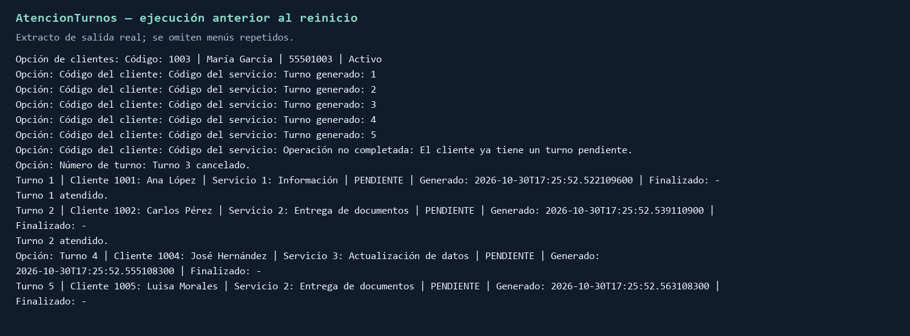
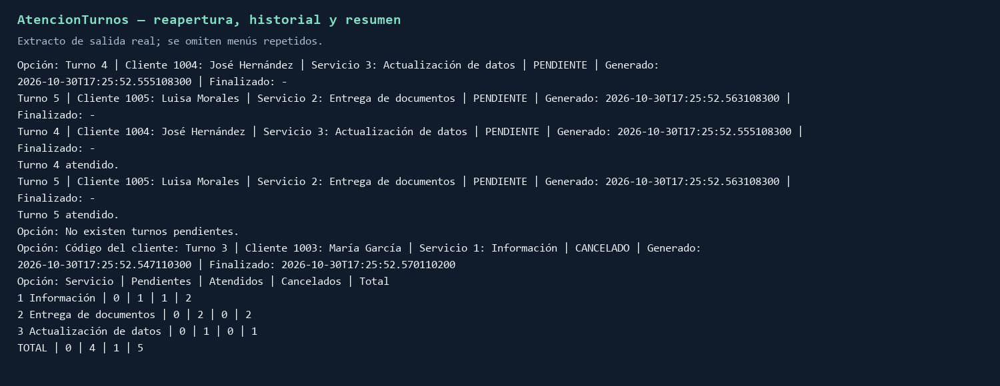

# Reporte breve de verificación final

## Base y entorno

Se unieron en una carpeta nueva los archivos exactos de los días 1–4 confirmados por
el grupo. No se modificaron las entregas anteriores ni se supuso que main estuviera
integrado. La validación es local; el contenido actual de las ramas remotas se deberá
revisar en los PR. Entorno ejecutado: OpenJDK 21, Maven 3.9.9 y SQLite JDBC 3.46.1.0.

## Pruebas ejecutadas

Maven compiló fuentes y pruebas con release 21 y terminó en BUILD SUCCESS.
PruebasFinales ejecutó **21/21 programas correctos**: las seis pruebas de día 2, cuatro
de día 3, nueve de día 4 y ValidacionFinalClientes / ValidacionFinalTurnos.
El script verificar.ps1 se ejecutó además correctamente y produjo BUILD SUCCESS.
El script ejecutar.ps1 también se ejecutó desde otro directorio y en una ruta con espacios;
Maven abrió el menú y la base inicial conservó los cinco clientes, tres servicios y cero turnos.
Las bases de prueba se crean en ubicaciones temporales y se cierran/eliminan al terminar.
No se usó data/turnos.db del usuario para las pruebas.

Se verificaron códigos inválidos/duplicados, nombres vacíos, teléfonos incorrectos,
clientes y servicios inactivos, pendientes únicos, bloqueos de desactivación, cola vacía,
FIFO, cancelaciones de extremos e intermedias, errores reales de escritura, recarga
fallida sin publicar estructuras parciales, cierre de recursos JDBC e inicialización
fallida con rollback. Las dos validaciones finales comparan todos los campos y el
orden de las instantáneas con SQLite después de cada operación de su secuencia.

## Demostración del catedrático

Se ejecutaron dos procesos Java independientes con la base inicial copiada del binario
que se entrega. Se conservó la semilla original sin turnos.

| Paso | Resultado observado |
|---|---|
| Buscar cliente 1003 | María García |
| Crear 1001/1, 1002/2, 1003/1, 1004/3, 1005/2 | Números 1, 2, 3, 4 y 5 |
| Otro pendiente para 1001 | Rechazado |
| Cancelar 3 | Cola 1, 2, 4, 5; estado CANCELADO con fecha |
| Atender dos | 1 y 2, en ese orden |
| Salir y volver a ejecutar | Cola reconstruida 4, 5 |
| Atender restantes | 4 y 5, en ese orden |
| Intentar otra atención | Aviso de que no hay pendientes |
| Historial de 1003 | Turno 3 cancelado y fecha final conservada |
| Resumen | Coincide con el enunciado |

| Servicio | Pendientes | Atendidos | Cancelados | Total |
|---|---:|---:|---:|---:|
| Información | 0 | 1 | 1 | 2 |
| Entrega de documentos | 0 | 2 | 0 | 2 |
| Actualización de datos | 0 | 1 | 0 | 1 |
| **Total** | **0** | **4** | **1** | **5** |

Se comprobaron las fechas finales no nulas, cinco clientes, tres servicios, cinco
turnos históricos y ausencia de violaciones de claves foráneas en la copia demostrada.

## Base final y script

La base de entrega fue creada ejecutando el Main Java actual: cinco clientes activos,
tres servicios activos y cero turnos. PRAGMA integrity_check devolvió ok y user_version
es 1. Se creó otra base desde sql/crear_y_cargar.sql y se compararon los datos iniciales,
columnas y relaciones con la base creada por Java: coincidieron. La demostración se
hizo sobre otra copia y no modifica la semilla incluida.

## Evidencias de salida real

Estas imágenes son representaciones de extractos del stdout capturado de los procesos,
con menús repetidos omitidos. No se presentan como fotografías de una ventana de VS Code.
Los TXT contienen la salida completa sin filtrar y permiten comprobar los extractos.

- evidencias/00_base_inicial.txt
- evidencias/01_demostracion_antes_reinicio.txt
- evidencias/02_demostracion_despues_reinicio.txt
- evidencias/PRUEBAS_FINALES.txt

## Resultado y pendientes humanos

No se detectaron errores funcionales en los escenarios ejecutados. No hay una
integración remota ni PR revisados por haber preparado este paquete. El grupo debe
completar nombres, carnés y número, revisar sus tres PR, repetir aceptación sobre main
y presentar su defensa. La aplicación se utiliza con una sesión por base de datos.
